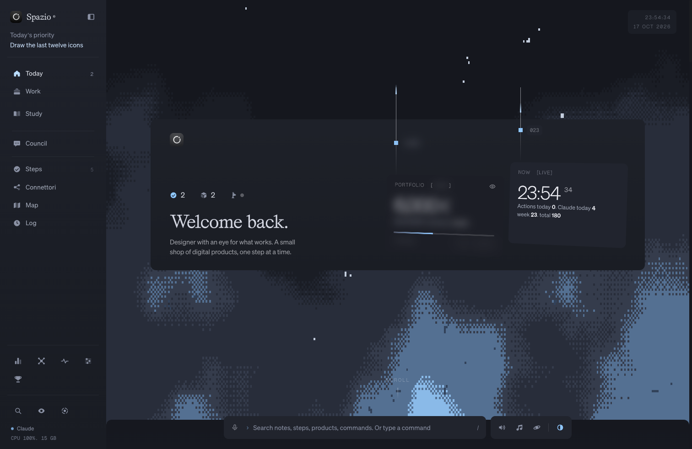

# Spazio Starter

Build your own personal operating system with Claude. Free.

Spazio is a calm dashboard that lives on your computer: what to do today, your next steps (yours and Claude's), your projects, a log of what Claude did for you, and a matching Dark Matte or White Matte look for the whole Mac. This starter doesn't give you the app: it gives Claude everything it needs to **build it with you**, step by step, the way you want it. The structure, the style, the reference screens, the themes, and a guide Claude follows.



## Start
1. Download this repo (green **Code** button, **Download ZIP**, unzip) or `git clone` it.
2. Open the folder in Claude Code (desktop app, Code tab, or `claude` in a terminal inside it).
3. Paste:

```
Read CLAUDE.md and build my Spazio with me, one phase at a time.
```

It takes a few sessions. Claude remembers where you stopped in `BUILD-PROGRESS.md`.

## What's inside
- `CLAUDE.md` the build guide Claude follows: seven phases, from an empty folder to your own dashboard.
- `build/SPEC.md` how Spazio is put together: one small local server, one page, your data in JSON files.
- `references/` the style guide and screenshots of the real Spazio in three themes, so Claude aims at the same look.
- `themes/` Dark Matte and White Matte for macOS, the wallpaper, folder icons and Chrome.

## Want the exact system, ready in 20 minutes?
**Spazio** is the full version I use every day, already built: Council of experts, Desk, Life OS, focus mode, dictation, the native Mac window, the skills that make Claude write its work into it, and a setup where Claude makes every part yours. Link in bio: juliendesigncraft.vercel.app

Made by Julien Design Craft (@juliendesigncraft). Free to use and share. Brygada 1918 is under the SIL Open Font License (`references/fonts/`). Wallpapers and icons in `themes/` are for your personal setup.
